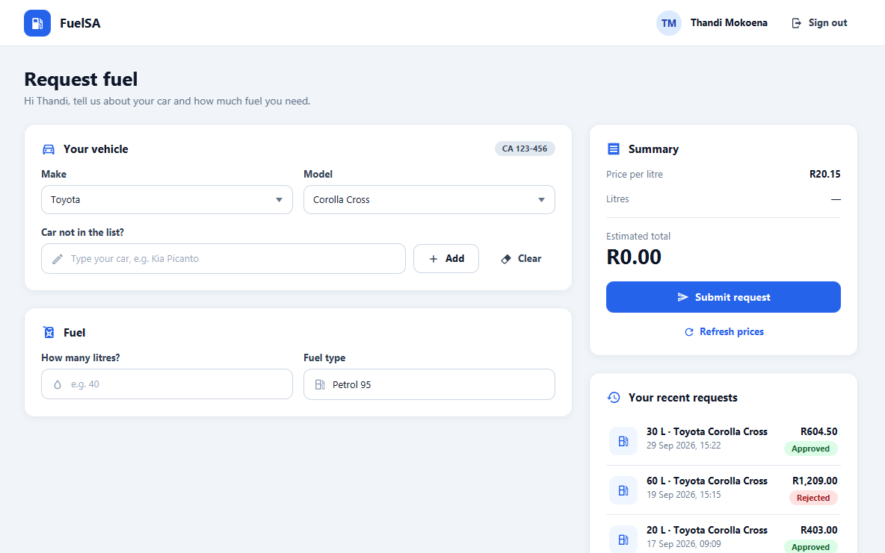
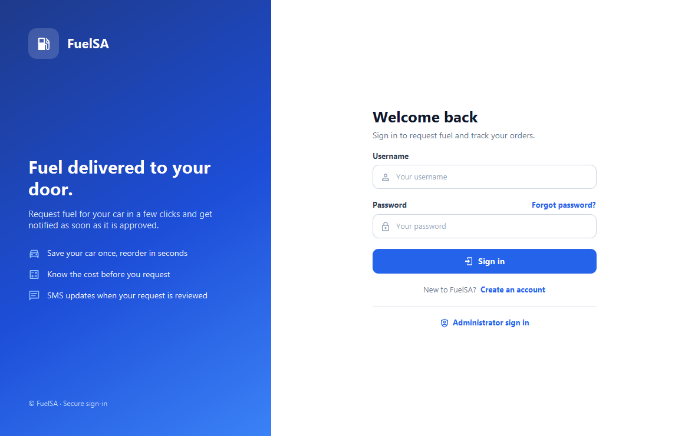
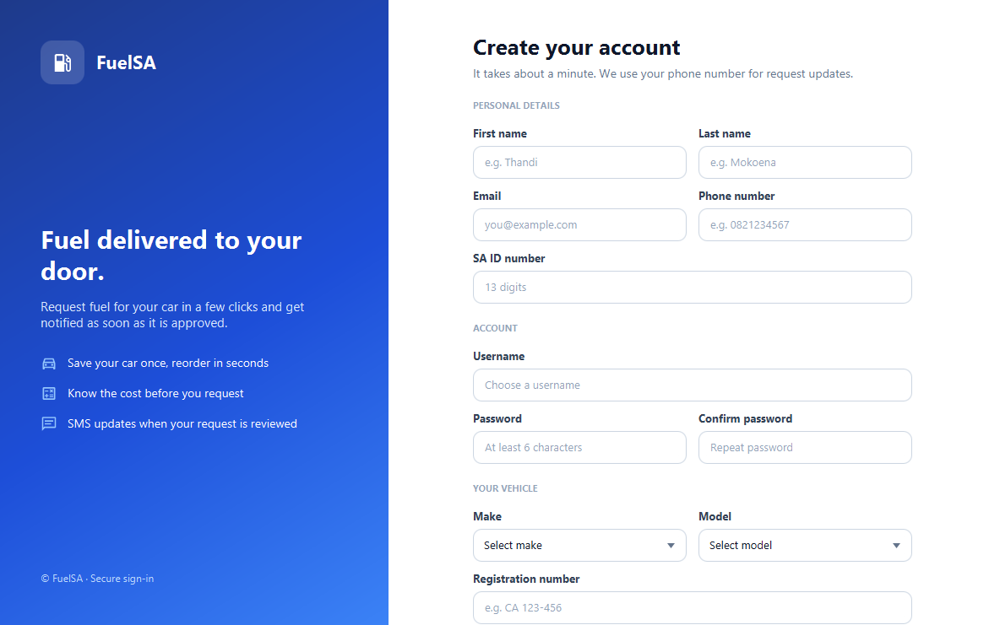
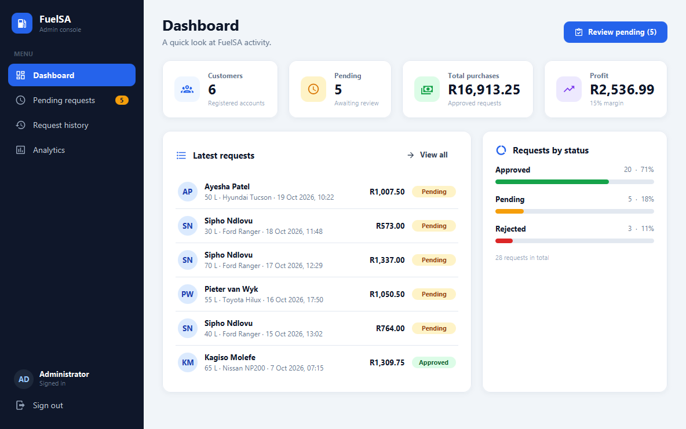
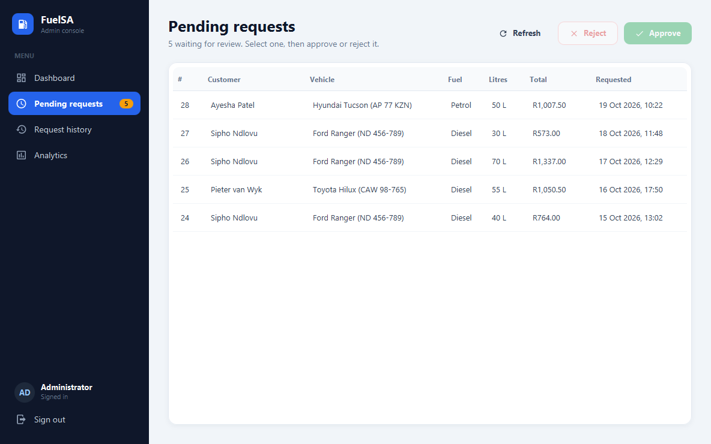
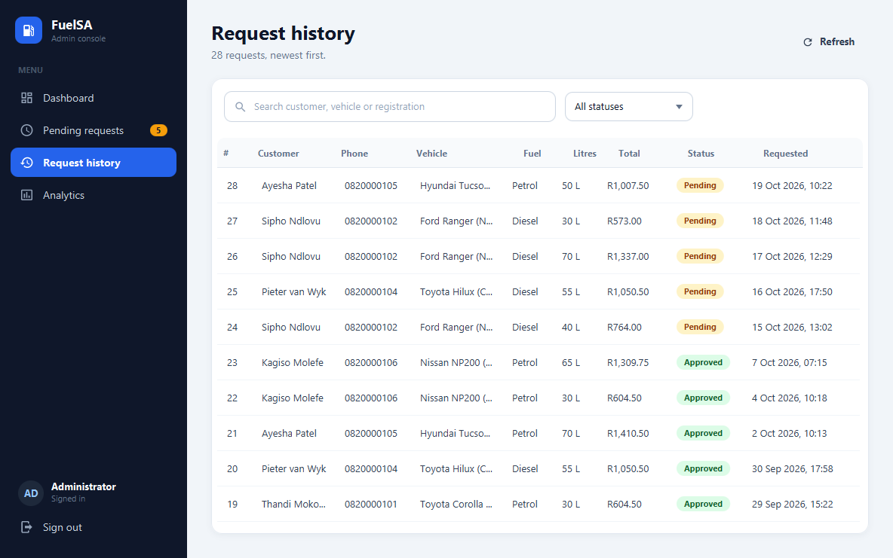
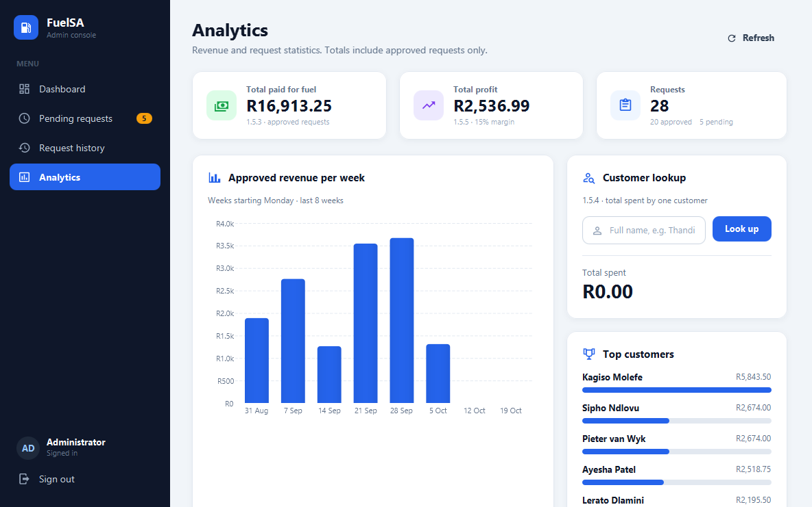

# FuelSA

A JavaFX desktop app for ordering fuel. Customers register their car, request fuel and see
the cost up front; administrators review requests, approve or reject them, and track
revenue. Customers and the admin get SMS updates through the BulkSMS API.



## Features

**Customers**
- Register with personal details, phone number and vehicle (make, model, registration)
- Request fuel with a live cost estimate
- Pick a car from the built-in list or add your own
- See your recent requests and whether each was approved, rejected or is still pending
- SMS confirmation when a request is submitted and when it is reviewed

**Administrators**
- Dashboard with customers, pending requests, total purchases and profit
- Approve or reject pending requests; the customer is notified by SMS
- Full request history with search and a status filter
- Analytics: total paid for fuel, profit, weekly revenue chart, top customers and a
  per-customer spend lookup

**Security**
- Passwords stored as salted PBKDF2 hashes; old plaintext passwords upgrade automatically
- No default admin password - the first admin account is created in the app
- API credentials read from environment variables or a git-ignored config file, never source code

## Screenshots

| Sign in | Register |
|---|---|
|  |  |

| Admin dashboard | Pending requests |
|---|---|
|  |  |

| Request history | Analytics |
|---|---|
|  |  |

*Screenshots use the built-in demo data - all names and numbers are made up.*

## Technologies

- Java 17
- JavaFX 21 (FXML + CSS)
- SQLite via [sqlite-jdbc](https://github.com/xerial/sqlite-jdbc)
- [Ikonli](https://kordamp.org/ikonli/) Material Design icons
- BulkSMS REST API
- Maven

## Getting started

### Requirements

- JDK 17 or later
- Maven 3.8+ (or the Maven bundled with IntelliJ IDEA)

JavaFX and all other libraries are downloaded by Maven - no separate JavaFX SDK is needed.

### Run

```bash
git clone https://github.com/Malwandla21-ict/FuelSA.git
cd FuelSA
mvn clean javafx:run
```

**IntelliJ IDEA:** open the folder as a Maven project (reload Maven if it was already open),
then run `app.Main`.

### Try it with demo data

```bash
mvn javafx:run -Pdemo
```

Demo mode uses a separate `fuel_app_demo.db` with 6 sample customers, an admin account and
28 fuel requests, so real data is never touched. SMS is switched off in demo mode.
In IntelliJ, add `--demo` as the program argument of the `app.Main` run configuration.

| Role | Username | Password |
|---|---|---|
| Customer | `thandi`, `sipho`, `lerato`, `pieter`, `ayesha` or `kagiso` | `Demo@1234` |
| Admin | `admin` | `FuelSA-demo-2026` |

Delete `fuel_app_demo.db` to start again with fresh demo data. These logins only exist in
the demo database.

### First run with real data

- The app creates `fuel_app.db` (SQLite) in the working directory.
- There is no default admin. Open **Administrator sign in**, type a username and click
  **Sign in** to create the admin account (password of 8+ characters, plus a phone number
  for new-request SMS alerts).

### SMS (optional)

Copy `fuelapp.properties.example` to `fuelapp.properties` and add your BulkSMS API token:

```properties
BULKSMS_TOKEN_ID=your-token-id
BULKSMS_TOKEN_SECRET=your-token-secret
BULKSMS_SENDER_ID=FuelSA
```

Environment variables with the same names take priority. Without a token the app works
normally and simply skips sending SMS.

## Project structure

```
FuelSA/
├── pom.xml
├── fuelapp.properties.example     # template for local SMS credentials
├── docs/screenshots/
└── src/main/
    ├── java/app/
    │   ├── Main.java              # entry point (--demo for sample data)
    │   ├── SceneController.java   # screen navigation
    │   ├── AppConfig.java         # reads env vars / fuelapp.properties
    │   ├── controllers/           # one controller per screen + admin sidebar
    │   ├── database/              # DatabaseManager, DAOs, DemoData
    │   ├── models/                # User
    │   ├── security/              # PasswordHasher (PBKDF2)
    │   ├── services/              # SMSService (BulkSMS)
    │   └── ui/                    # shared formatting, badges, messages
    └── resources/
        ├── css/styles.css         # design system
        ├── data/cars.xml          # car makes and models
        └── fxml/                  # screen layouts
```

## Security notes

- Never commit `fuelapp.properties`, `.env`, `*.db` or `data/`. They are git-ignored because
  they hold API credentials and customers' personal information.
- If a credential is ever committed, revoke it with the provider first - deleting it from
  the repository does not remove it from git history.
